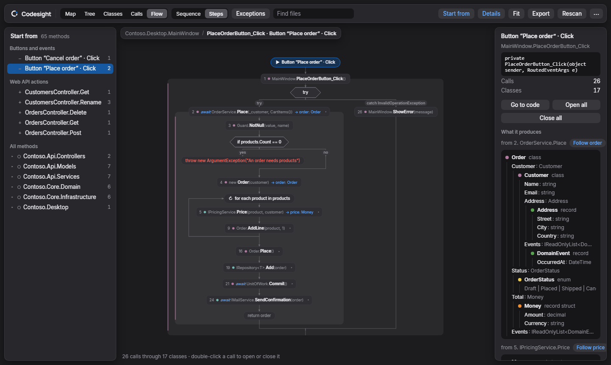
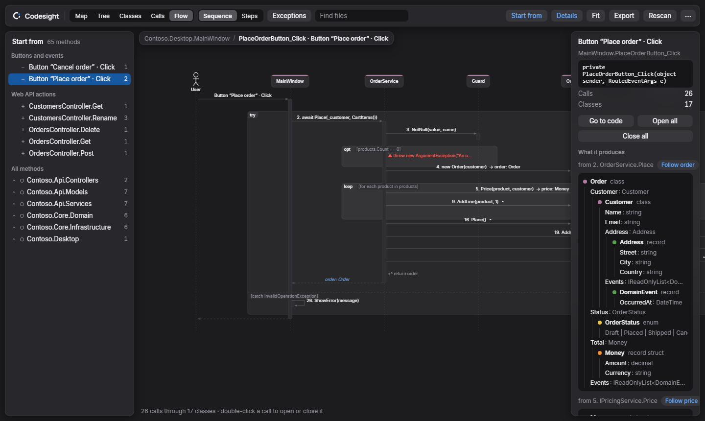
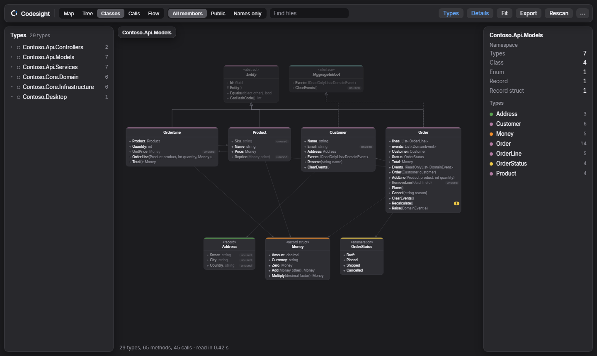
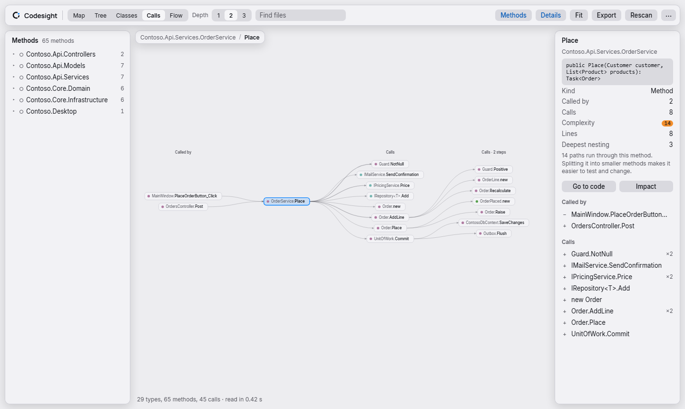
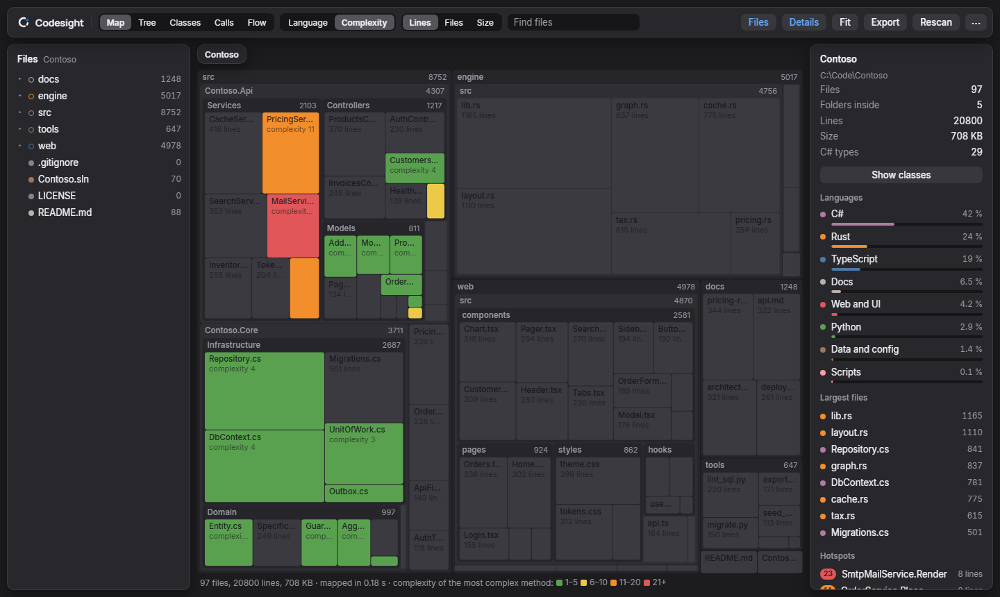

<p align="center">
  <picture>
    <source media="(prefers-color-scheme: dark)" srcset="brand/svg/codesight-readme-header-on-dark.svg">
    
  </picture>
</p>

Codesight is a Visual Studio extension that shows you how your C# code works. Press a button in your app and see what runs, in order, through which classes. See how the classes fit together. Find the parts worth a look: complex methods, code nothing uses, exceptions nothing catches, and everything a change would reach.

It sits in a window beside your code, follows the Visual Studio theme, and takes you to the line behind anything you click.



## Install

1. Download `Codesight-<version>.vsix` from the [latest release](https://github.com/gowthamjeyabalan/Codesight/releases/latest).
2. Close Visual Studio and double-click the file. The installer asks which Visual Studio to add it to (2022 or 2026). The file is not digitally signed, so the installer says so; continue.
3. Open a solution, then **View > Other Windows > Codesight**. You can also run `View.Codesight` in the Command Window or bind it to a shortcut.

Codesight reads the C# projects of the open solution (a `.sln`). The folder map also works with **File > Open Folder**.

## What it shows

### Flow: what happens when you press a button

Pick a starting point: a button or other event (named after the control in your XAML, or from `button.Click += ...`), a command, a web API action, `Main`, or any method. Codesight follows the code from there.

- Every call into your own code, numbered in the order it runs, opened up into what that method does.
- The decisions (`if`, `switch`), loops, `try`/`catch` blocks, early returns and throws around them.
- For a call through an interface or a virtual method, each implementation it can go to.
- What goes into each call and where its result goes: `ReadAllRows(inputPath) → raw: List<string[]>`.
- **What it produces:** the result types opened up into their fields, nested types and enum values.
- **Follow** a value to see every step that makes it, works on it, passes it on, checks it, returns it or throws it.
- **Exceptions:** every throw, the catch that stops it, and in red the ones nothing catches.

Draw it as a **sequence** diagram (a column per class, calls going down the page) or as numbered **steps** (a flowchart). Double-click a call to open or close it.



### Classes

A UML class diagram of a namespace, of a type and everything it inherits, implements or uses, or of the types in a file or folder. Members show their visibility, methods worth a look show their complexity, and code with no use found is marked.



### Calls and impact

One method in the middle, its callers on the left and what it calls on the right. **Impact** shows everything a change to a method or type would reach, back to the buttons and other starting points it affects.



### Map and tree

Every folder and file of the solution as a treemap or a tree, sized by lines, files or bytes, and coloured by language or by complexity. Updates by itself as files change.



### Everywhere

- **Follow the editor:** the open view selects the method or class your caret is in. Dock Codesight beside your code to see it follow live.
- **Export** any diagram, whole, as PNG or SVG, or copy it as Mermaid text for Markdown and GitHub.
- Search, a details panel for whatever you pick, and **Go to code** on everything.
- The C# is read again a few seconds after you stop typing. Code the build generates (`obj`, `*.g.cs`) is left out.
- Light and dark themes that follow Visual Studio, with see-through panels (Settings: Acrylic or Clear).

### Limits

Codesight reads your code; it does not run it. A flow shows every path that *could* run, with types rather than live values. Events, dependency injection and reflection can hide where a call really goes, and "no use found" means nothing in the C# uses it (XAML bindings or reflection still might).

## Building

Visual Studio 2022 or 2026. The build tools come from NuGet, so the Visual Studio extension development workload is only needed to open the project in the IDE and press F5.

```bash
"C:\Program Files\Microsoft Visual Studio\18\Community\MSBuild\Current\Bin\MSBuild.exe" Codegram.sln -restore -p:Configuration=Release
```

This builds `src/Codegram/bin/Release/Codegram.vsix`. With `-p:Configuration=Debug` it also deploys to the experimental instance (`devenv /rootsuffix Exp`). The folder and project keep the extension's first name, Codegram.

The web UI runs in a plain browser with made-up sample data, so it can be worked on without Visual Studio: open `src/Codegram/web/index.html`, optionally with `?view=flow&flowStyle=steps&theme=light`.

| Path | What |
|---|---|
| `src/Codegram/CodegramPackage.cs` | Package and the View menu command |
| `src/Codegram/CodegramView.cs` | WebView2 host: solution events, theme, file watcher, the editor caret, open file, save and copy |
| `src/Codegram/FolderScanner.cs` | Walks the folder, counts lines, reads `.gitignore` |
| `src/Codegram/CodeAnalyzer.cs` | Roslyn: types, members, inheritance, calls, uses, complexity, entry points |
| `src/Codegram/FlowAnalyzer.cs` | Roslyn: the ordered flow from one method, with decisions, loops, data and exceptions |
| `src/Codegram/web/` | The diagrams (plain HTML, CSS and JavaScript, no libraries) |
| `brand/`, `tools/brand/` | The logo and its generator (see [brand/README.md](brand/README.md)) |

## License

MIT, see [LICENSE](LICENSE).
