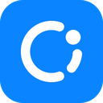
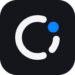

# Codesight brand

<p>
  
  
</p>

## The idea

A lowercase "c" and "i" on one circle: Codesight is **c**ode + **i**nsight. The "c" takes the left side of the circle. On the right, the "i" is a short piece of the same circle, and its dot (Hub Blue) sits further round, above it. The three pieces never touch, but they read as one curve: code and insight belong together.

Codesight is a sibling of Grapht and Overlay, so the mark follows Grapht's rules: the same 100-unit box, round strokes, one blue dot. As with Grapht and Overlay, the app icon is the white mark on a Hub Blue tile, and the Night tile is the alternate.

## Construction

Angles are in degrees: 0° is right, clockwise is positive. The pieces share one circle with equal gaps between them.

| Part | Regular (40 px and up) | Small (32 px and down) |
|---|---|---|
| Circle | centre (50, 50), radius 28 | radius 30 |
| Stroke | 10, round ends | 12.5, round ends |
| c | from -72° round the left to 72° | same |
| i | from 5.2° to 39.5° | from 12.3° to 35.1°, shorter so the gaps stay open |
| Dot | at -33.4° on the circle, radius 8, Hub Blue | at -29.9°, radius 9 |
| Gaps | 12° between pieces | 13° |
| Icon | 100 x 100 square, corner radius 22.4, mark scaled 0.9 and centred | same |

Colours: Hub Blue `#0A84FF`, Night `#14161C`, Paper `#F5F5F7`. The wordmark is "codesight" in lowercase Manrope ExtraBold. In the lockups, the mark's circle spans the wordmark's lowercase letters, like one more letter.

## Files

| Folder | What | Use |
|---|---|---|
| `svg/codesight-mark-*` | The mark alone: `color-on-dark`, `color-on-light`, `white`, `ink` | Docs, slides, anywhere the mark sits on a plain background |
| `svg/codesight-icon-blue*`, `png/codesight-icon-blue-*` | The app icon: white mark on Hub Blue | Extension icon, Marketplace, favicons. Use `-small` at 32 px and below |
| `svg/codesight-icon-dark*`, `png/codesight-icon-dark-*` | Alternate: Paper mark and blue dot on Night | Dark surfaces where a blue tile is too loud |
| `ico/codesight.ico`, `ico/codesight-dark.ico` | Windows icons, 16 to 256 px, each size drawn on its own | Shortcuts, installers |
| `svg/codesight-wordmark-*` | "codesight" alone | Rare; prefer a lockup |
| `svg/codesight-lockup-horizontal-*`, `svg/codesight-lockup-stacked-*` | Mark and wordmark together, `on-dark` and `on-light` | Headers, about screens |
| `svg/codesight-readme-header-*` | Lockup and tagline | The top of the README |
| `png/codesight-social-banner-1280x640.png` | Lockup and tagline on Night | Repository social preview, posts |
| `svg/favicon.svg` | Small blue icon | Web pages |

All text in the SVGs is outlined (paths), so they look the same without the fonts installed.

The extension uses `codesight-icon-blue-128.png` (installer and Marketplace icon), `-200.png` (Marketplace preview) and `-16.png` (the View menu), copied into `src/Codegram/Resources`. Codesight's own header draws the small cut in the text colour with the accent dot.

## Rules

- Keep one blue dot. Never add a second accent colour to the mark.
- On dark backgrounds use Paper strokes; on light ones use Night. The dot stays Hub Blue, except in single-colour versions (`white`, `ink`).
- Leave clear space around the mark of at least the dot's diameter.
- Don't rotate the mark, join the pieces, or move the dot. Three pieces on one circle are the idea.
- Use the small cut at 32 px and below.

## Regenerating

Everything here is generated from one geometry, so every size stays consistent:

```
python tools/brand/make_brand.py
```

Run it from the repository root (it needs Pillow and fontTools). It reads the fonts in `src/Codegram/web/fonts` and writes into `brand/`. The geometry is the `REGULAR` and `SMALL` cuts at the top of `tools/brand/make_brand.py`.
